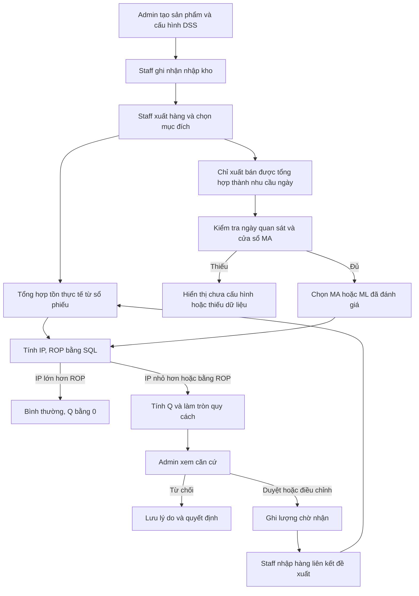

# Nghiệp vụ và triển khai N07 DSS

Tài liệu này đối chiếu kế hoạch `Ke_hoach_N07_DB_chi_tiet_IS402 (1) (1).docx` với phần mềm Laravel hiện có. Bản Word là đặc tả và dữ liệu minh họa, không phải bản sao cơ sở dữ liệu thật. Lược đồ PostgreSQL trong Word được chuyển sang migration Laravel tương thích MySQL/MariaDB của XAMPP. Không chạy trực tiếp SQL PostgreSQL lên MySQL.

## 1. Thứ tự module và trách nhiệm

| Thứ tự | Module | Use Case | Chức năng và nghiệp vụ |
|---|---|---|---|
| 1 | Tài khoản | UC01, UC05 | Admin cấp tài khoản, thay đổi vai trò, khóa/mở khóa. Tài khoản khóa không đăng nhập được; phiên cũ bị chặn ở lần truy cập kế tiếp. Không khóa chính mình hoặc loại bỏ admin hoạt động cuối cùng. |
| 2 | Danh mục và sản phẩm | UC03, UC04 | Quản lý sản phẩm, danh mục, giá tham khảo và trạng thái kinh doanh. Mã sản phẩm tự sinh dạng SP0001. Sản phẩm có lịch sử kho không xóa cứng. |
| 3 | Nhập, xuất, tồn | UC06–UC08 | Phiếu nhiều dòng, số lượng nguyên dương, chặn xuất vượt tồn, lưu người thực hiện và chứng từ. Nhập/xuất được xác nhận ngay khi lưu; không có phiếu nháp hoặc hủy phiếu trong phiên bản này. |
| 4 | Phân tích nhu cầu và cảnh báo | UC09, UC11, UC12 | MA 7/14/30 ngày, SS thủ công/thống kê, Lead Time, mục tiêu dự trữ và quy cách. Thiếu cấu hình hoặc lịch sử không được tạo đề xuất số lượng. |
| 5 | Quyết định, đặt hàng và nhận kho | UC14 | Admin duyệt/điều chỉnh/từ chối đề xuất; xác nhận đặt hàng thực tế với NCC; nhận hàng từng phần (partially_received) hoặc nhận đủ (fulfilled); hủy đơn an toàn (cancelled). |
| 6 | Dự báo & DSS nâng cao | UC10 | Admin chạy MA và Linear Regression riêng từng sản phẩm. Tự động phát hiện Censored Demand khi đứt hàng, tính toán Lead Time thực tế (đợt đầu và nhận đủ), Fallback Safety Stock khi phương sai xấp xỉ 0. |
| 7 | Báo cáo và OLAP | UC02, UC13, UC15, UC16 | BC01–BC05 đúng mã trong Word; thêm bán chạy, lịch sử quyết định và nhật ký. OLAP theo danh mục/sản phẩm/tháng, lọc nhiều chiều, pivot nhập/xuất. |
| 8 | Dữ liệu demo và dọn dẹp | Phần 6.4 và 13 | Lệnh `dss:demo` tạo 20 sản phẩm mang tiền tố DEMO-N07. Lệnh `dss:demo-clean` dọn sạch an toàn dữ liệu mô phỏng khi nghiệm thu hoặc trả lại kho sạch. |

## 2. Vòng đời nghiệp vụ



Mỗi thao tác kho ghi đầu phiếu, chi tiết và lượng nhận của đề xuất trong cùng transaction. Khóa dòng sản phẩm và đề xuất khi cập nhật để tránh hai phiếu cùng dùng một lượng tồn. Sau khi lưu, hệ thống tính lại phân tích. Duyệt đề xuất và kiểm tra dữ liệu mới nhất nằm trong một transaction; đề xuất cũ bị thay thế không thể duyệt lại.

## 3. Phân loại xuất kho và dữ liệu cũ

| Mục đích | Giảm tồn | Dùng làm nhu cầu dự báo |
|---|---|---|
| Tiêu thụ nội bộ (`consumption`) | Có | Có |
| Bán / thương mại (`sale`) | Có | Có |
| Hàng hỏng (`damage`) | Có | Không |
| Trả nhà cung cấp (`return_vendor`) | Có | Không |
| Điều chuyển (`transfer`) | Có | Không |
| Kiểm kê điều chỉnh (`adjustment`) | Có | Không |
| Khác (`other`) | Có | Không |
| Chưa xác định (`unknown`) | Có | Không |

Migration gán phiếu cũ là `unknown` vì không có bằng chứng chúng đều là bán hàng. Admin vào Kho → chi tiết phiếu xuất → **Rà soát mục đích xuất**, chọn mục đích và ghi lý do. Việc này không đổi số lượng tồn; có nhật ký trước/sau và làm mới DSS. Không xác nhận toàn bộ phiếu cũ là bán nếu chưa đối chiếu.

## 4. Cấu hình và tính DSS

Admin mở Đề xuất nhập hàng → Cấu hình phân tích cho sản phẩm:

- **MA:** 7, 14 hoặc 30 ngày đã kết thúc, không tính hôm nay đang bán dở.
- **Ngày dữ liệu đầy đủ:** ngày bắt đầu mà Admin đã xác nhận lịch sử đầy đủ. Ngày không có xuất bán kể từ mốc này được hiểu là 0. Đây là xác nhận nghiệp vụ, không phải hệ thống tự suy đoán dữ liệu thiếu bằng 0.
- **L:** số ngày chờ hàng, từ 0 đến 365.
- **T:** số ngày dự trữ sau khi hàng về, từ 0 đến 365.
- **SS thủ công:** lượng dự phòng do Admin nhập, không âm.
- **SS thống kê:** làm tròn lên `z × độ lệch chuẩn nhu cầu ngày × sqrt(L)`; z là hệ số Admin cấu hình. Giả định nhu cầu ngày quan sát đủ và Lead Time cố định.
- **Quy cách:** số lượng trong một lô đặt, nguyên dương. Bản hiện tại dùng số lượng nguyên theo đơn vị sản phẩm, chưa xử lý kg/lít phân số.
- **Phương pháp:** MA hoặc tự chọn ML khi đã có đánh giá đủ tốt.

Các phép tổng hợp nhu cầu, tồn, hàng chờ về và công thức IP/ROP/Q được thực hiện bằng SQL trong `ReorderRecommendationService` và `ReorderCalculator::calculateSql`. `ReorderCalculator::calculate` giữ phiên bản tính độc lập để kiểm chứng công thức bằng ví dụ tính tay.

```text
d = tổng xuất tiêu thụ (consumption + sale) trong n ngày đầy đủ / n
On_Order = SUM(ordered_quantity - received_quantity) cho các đơn ordered / partially_received
IP = tồn thực tế (On_Hand) + On_Order - lượng cam kết (hiện tại = 0)
ROP = d × L + SS
Nếu IP > ROP: Q = 0 (Bình thường, NORMAL)
Nếu IP ≤ ROP: Q = ceil(max(0, d × (L + T) + SS - IP) / quy_cách) × quy_cách (Cần nhập, REORDER)
```

Quy tắc vòng đời đề xuất:
- `pending`: DSS phát sinh khi IP <= ROP. On-Order = 0.
- `approved`: Admin duyệt số lượng trần (approved_quantity). On-Order vẫn = 0 vì chưa đặt NCC.
- `ordered`: Admin/Staff xác nhận đặt hàng thực tế (ordered_quantity <= approved_quantity). Khi đó On-Order = ordered_quantity.
- `partially_received`: Đã nhập 1 phần hàng. On-Order = ordered_quantity - received_quantity.
- `fulfilled`: Đã nhận đủ hàng. On-Order = 0.
- `rejected`: Admin từ chối đề xuất. On-Order = 0.
- `cancelled`: Hủy đơn đặt hàng / hủy phần chưa giao. On-Order lập tức hoàn nguyên về 0.

Cơ chế nâng cao:
- **Fallback Safety Stock**: Khi `safety_mode = 'statistical'`, nếu hệ số z > 0 nhưng phương sai nhu cầu xấp xỉ 0 (do nhu cầu đều), tự động áp dụng đệm an toàn cơ sở ceil(0.15 * d * L) hoặc ngưỡng sàn manual_safety_stock.
- **Lead Time thực tế**: Hệ thống đo thời gian thực tế từ ordered_at đến phiếu nhập đầu tiên (giao đợt đầu) và đến phiếu nhập cuối cùng (giao đủ). Cung cấp nút đồng bộ Lead Time kế hoạch theo thực tế.
- **Censored Demand**: Khi kho hết hàng (On_Hand <= 0) kéo dài, hệ thống phát hiện nhu cầu ghi nhận bị méo, tính toán nhu cầu hiệu chỉnh (adjusted_demand) trên các ngày có hàng và cung cấp số lượng gợi ý bù đắp cho Admin.

Ví dụ trong Word: d=13, L=4, T=7, SS=20, IP=70 → ROP=72, Q=93. Nếu quy cách 12 → Q=96. Nếu IP=80 → không đề xuất dù mức tồn mục tiêu cao hơn 80. ROP được lưu dạng thập phân; không dùng ROP làm tròn để kích hoạt sai cảnh báo.

Trạng thái phân tích: `NORMAL`, `REORDER`, `MISSING_CONFIG`, `INSUFFICIENT_DATA`, `INVALID_DATA`. Trạng thái xử lý riêng: `pending`, `approved`, `rejected`, `fulfilled`, `superseded`, `no_action`. Khi điều chỉnh lượng duyệt, lượng gốc vẫn giữ nguyên; chênh lệch và lý do nằm trong lịch sử, không cần tạo một loại trạng thái đơn hàng mới.

## 5. Nhận hàng và tránh nhập trùng

Duyệt 100, đã nhận 40 → hàng đang về là 60. Nếu tồn hiện tại là 40 thì IP là 100, không phải 140. Staff chọn **Tạo phiếu nhập** từ đề xuất đã duyệt; chọn sản phẩm và nhập số lượng thực nhận. Hệ thống chặn nhận quá phần còn lại, chặn liên kết sai sản phẩm và chặn liên kết đề xuất vào phiếu xuất. Nhận đủ chuyển trạng thái `fulfilled`.

Điều chỉnh lượng duyệt hoặc từ chối bắt buộc có lý do. Lịch sử DSS lưu giá trị đầu vào và công thức tại thời điểm tạo; thay đổi cấu hình về sau không viết lại căn cứ cũ. Nhật ký nghiệp vụ lưu các thay đổi cấu hình, người dùng và rà soát mục đích xuất; không lưu mật khẩu.

## 6. Dự báo và đánh giá

BC05 dùng Linear Regression đơn biến theo chỉ số ngày (`linear-trend-v1`). Mỗi lần dự báo một ngày được huấn luyện trên cửa sổ quá khứ, sau đó so với lượng bán thực tế của ngày kế tiếp. Bảy ngày kiểm thử cuối được đánh giá theo thứ tự thời gian; không dùng tương lai để dự báo quá khứ.

- MA và hồi quy được so sánh trên cùng bảy ngày, cùng sản phẩm và đơn vị.
- MAE là sai số tuyệt đối trung bình; RMSE là căn trung bình bình phương sai số.
- Chỉ chọn hồi quy nếu **cả MAE và RMSE nhỏ hơn MA**; hòa hoặc không tốt hơn thì chọn MA.
- Cần tối thiểu n+7 ngày đầy đủ, n là cửa sổ MA.
- Kết quả lưu chuỗi dữ liệu và mã SHA-256 để tái lập.
- DSS chỉ dùng lần chạy có ngày kết thúc là hôm qua, cửa sổ khớp và dữ liệu không đổi. Kết quả cũ hoặc dữ liệu đã sửa sẽ quay về MA cho đến khi Admin chạy đánh giá lại.
- Dự báo ngày kế tiếp được dùng như tốc độ nhu cầu/ngày cho chính sách đặt hàng, không phải dự báo tổng tuần. Đây là mô hình xu hướng đơn giản, chưa mô hình hóa khuyến mại, mùa vụ phức tạp hoặc tình trạng hết hàng làm mất doanh số quan sát.

## 7. Báo cáo và SQL

| Báo cáo | Đường dẫn | Nội dung |
|---|---|---|
| BC01 | `/reports/bc01` | Tồn, đang về, IP, nhu cầu/ngày, SS, ROP và trạng thái; lọc sản phẩm/danh mục/trạng thái. |
| BC02 | `/reports/bc02` | Tồn đầu kỳ, nhập, tổng xuất, xuất tiêu thụ, xuất khác/chưa rõ và tồn cuối kỳ. |
| BC03 | `/reports/bc03` | Sản phẩm cần nhập, Q gốc, Q duyệt, đã nhận, IP/ROP và giải thích. Lịch sử quyết định đầy đủ ở `/dss/history`. |
| BC04 | `/reports/bc04` | Hàng còn tồn và có trên 60 ngày bao phủ, hoặc không có tiêu thụ trong kỳ; giá trị vốn tồn tham khảo. |
| BC05 | `/reports/bc05` | Các lần chạy dự báo theo sản phẩm, MAE/RMSE, phương pháp chọn và chuỗi đầu vào. |
| Bán chạy | `/reports/best-selling` | Chỉ tính xuất tiêu thụ, không tính hàng hỏng/điều chuyển. |
| OLAP | `/reports/olap` | Group by danh mục/sản phẩm/tháng; slice loại giao dịch; dice ngày và sản phẩm/danh mục; pivot nhập/xuất. |

Views: `v_daily_demand` tổng hợp xuất bán theo ngày, `v_stock_balances` tính tồn từ sổ giao dịch, `v_reorder` lấy bản phân tích mới nhất từng sản phẩm, `v_inventory_facts` làm nguồn sự kiện đa chiều. `v_reorder` là ảnh chụp lần tính mới nhất; trang nghiệp vụ gọi refresh trước khi đọc. Với truy vấn SQL thủ công cần hiểu thời điểm của ảnh chụp, không xem nó là phép tính tự cập nhật theo đồng hồ.

BC04 dùng tồn tại cuối kỳ được chọn; không so nhu cầu kỳ cũ với tồn hiện tại. Dashboard đếm `REORDER` từ cùng bản phân tích với BC01 và chỉ tính sản phẩm đang kinh doanh. Ngưỡng tồn thấp 0–10 trên dashboard là chỉ báo bổ sung, khác với ROP theo tốc độ bán.

## 8. Chạy dự án và cập nhật dữ liệu

Máy hiện tại đã áp dụng hai migration ngày 18/11/2026. Bản sao lưu trước cập nhật nằm trong `storage/app/backups/`; giữ riêng tư vì chứa dữ liệu tài khoản và nghiệp vụ.

Trên một bản cài đặt khác, bật MySQL XAMPP, cấu hình `.env`, rồi chạy:

```powershell
cd C:\xampp\htdocs\N07_DSS
composer install
php artisan migrate
php artisan storage:link
php artisan users:create-admin
php artisan serve
```

Mở `http://127.0.0.1:8000/login`. Nếu dùng Apache XAMPP, mở `http://localhost/N07_DSS/public/login`. CSS của các màn hình đang dùng nằm trong `public/css/app.css`, không cần chạy Vite để sử dụng các màn hình này. Không dùng `migrate:fresh` trên dữ liệu cần giữ.

Để tạo dữ liệu minh họa khi cần:

```powershell
php artisan dss:demo
```

Lệnh cần một admin hoạt động đã tồn tại; không tạo mật khẩu mặc định. Tạo 20 sản phẩm, 183 ngày đến hôm qua, tồn khớp tổng nhập trừ xuất. Chạy lần hai không thêm trùng. Lệnh chưa được chạy trên cơ sở dữ liệu thật trong lần tích hợp này để tránh trộn hàng demo vào hoạt động hiện có; đã được kiểm thử trong cơ sở dữ liệu SQLite tách biệt. Nếu demo vào một ngày khác, chuẩn bị một cơ sở dữ liệu demo riêng mới thay vì kéo dài giả lịch sử của hàng thật.

## 9. Kịch bản vận hành sau cập nhật

1. Admin kiểm tra tài khoản đang dùng và quyền của Staff.
2. Rà soát các phiếu xuất cũ; xác nhận mục đích và lý do từ chứng từ.
3. Mở DSS, cấu hình từng sản phẩm và xác nhận mốc dữ liệu đầy đủ. Chưa biết mốc thì giữ trạng thái chưa cấu hình.
4. Staff lập phiếu nhập/xuất và chọn đúng mục đích.
5. Xem BC01, DSS để giải thích d, L, SS, IP, ROP và Q.
6. Admin duyệt hoặc điều chỉnh; xem lịch sử để kiểm tra dấu vết.
7. Staff nhập hàng liên kết; thử nhận từng phần và kiểm tra lượng chờ còn lại.
8. Admin chạy BC05 khi đủ dữ liệu; xem phương pháp được chọn và giới hạn mô hình.
9. Kiểm tra BC02 đối soát nhập–xuất–tồn và BC04 để tránh giữ quá nhiều vốn.

## 10. Kiểm chứng và giới hạn phạm vi

Chạy `php artisan test` để kiểm tra nghiệp vụ với SQLite trong bộ nhớ, không xóa dữ liệu MySQL. Bộ kiểm thử gồm ví dụ số của Word, phân quyền, khóa tài khoản, trạng thái thiếu dữ liệu, loại trừ xuất hỏng, duyệt có lý do, nhận từng phần, chặn nhận vượt, chọn mô hình và đồng nhất dashboard/báo cáo. Đã kiểm tra render các trang chính với MySQL hiện có bằng HTTP kernel; kiểm tra trực tiếp bố cục bằng ảnh trình duyệt chưa thực hiện được vì công cụ không hỗ trợ trình duyệt Cốc Cốc hiện tại.

Không triển khai các phần tài liệu đánh dấu ngoài phạm vi/tùy chọn: nhiều kho, kế toán, thanh toán, gửi đơn tự động cho nhà cung cấp, chatbot, LSTM, xuất Excel/PDF và giao dịch hủy/đảo phiếu. Không tạo báo cáo Word hoặc slide nộp bài mới trong yêu cầu tích hợp phần mềm này. Sơ đồ và hướng dẫn tại đây phục vụ giải thích hệ thống; bộ hồ sơ học phần có thể sử dụng đặc tả Word nguồn kết hợp các thay đổi được ghi trong tài liệu này.
